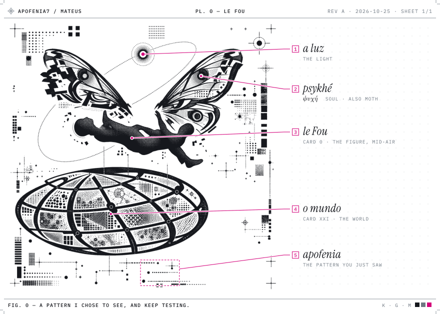
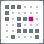
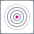
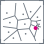
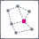
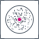
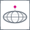
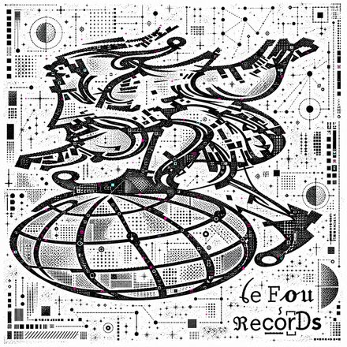
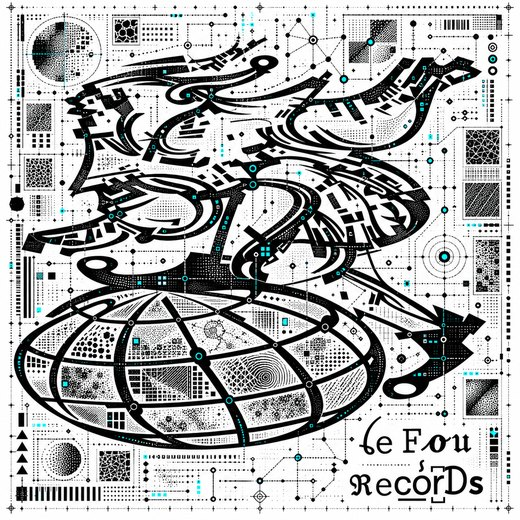
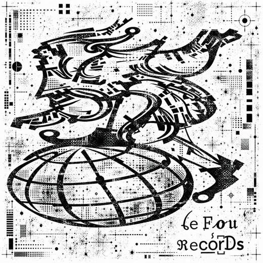

<!-- Pl. 0 · rev A · 2026-10-25. Assets in ./assets/plate0 are generated; states in the ledger are set by the owner and only move with evidence. -->
<picture><source media="(prefers-color-scheme: dark)" srcset="./assets/plate0/pl0-dark.svg"><source media="(prefers-color-scheme: light)" srcset="./assets/plate0/pl0-light.svg"></picture>

<h1 align="center">mateus</h1>

<em>Apophenia, with a method: see the pattern, then test it.</em>

<a href="https://mateusabreu.vercel.app">website&nbsp;↗</a> &nbsp;·&nbsp; <a href="https://apofenia.art">apofenia&nbsp;↗</a> &nbsp;·&nbsp; <a href="https://alternamentesaude.com">alternamente&nbsp;↗</a>

PL. 0 — LEGEND

1. ***a luz*** — flying insects, moths included, don't fly at the light: they turn their backs to it, as if it were the sky, and over a lamp they flip and dive.1
2. ***psykhé*** (ψυχή) — Greek for soul and mind; also, butterfly or moth.2
3. ***le Fou*** — the figure from my avatar, mid-air. In tarot, the card without a number, often read as the beginning; in chess, the piece that moves on the diagonal.
4. ***o mundo*** — card XXI. In the 15th-century Visconti-Sforza deck, The World is a globe with a city inside.3
5. ***apofenia*** — seeing meaningful connections between unrelated things; a term from psychiatry.4 The method is to see the pattern and then test it. The test is below.

## The test

WHAT RUNS · AS OF 2026-10-25 · STATES ARE SELF-REPORTED AND ONLY MOVE WITH EVIDENCE

<table>
<tr><th align="left">system · evidence</th><th align="left">state</th></tr>
<tr><td><code>01</code>&nbsp; <b>Mateus OS</b> private</td><td> 7/7&nbsp;·&nbsp;operable</td></tr>
<tr><td><code>02</code>&nbsp; <b>Website</b> mateusabreu.vercel.app · <a href="https://mateusabreu.vercel.app">live&nbsp;↗</a></td><td> 5/7&nbsp;·&nbsp;deployed</td></tr>
<tr><td><code>03</code>&nbsp; <b>Apofenia · site</b> apofenia.art · <a href="https://apofenia.art">live&nbsp;↗</a></td><td> 5/7&nbsp;·&nbsp;deployed</td></tr>
<tr><td><code>04</code>&nbsp; <b>Alternamente · site</b> alternamentesaude.com · <a href="https://alternamentesaude.com">live&nbsp;↗</a></td><td> 5/7&nbsp;·&nbsp;deployed</td></tr>
<tr><td><code>05</code>&nbsp; <b>Hermes</b> team agent · <a href="https://github.com/apofenia7/hermes-agent">in use&nbsp;↗</a></td><td> 5/7&nbsp;·&nbsp;deployed</td></tr>
<tr><td><code>06</code>&nbsp; <b>apofenia-os</b> private</td><td> 3/7&nbsp;·&nbsp;verified</td></tr>
<tr><td><code>07</code>&nbsp; <b>Apofenia Radar</b> private</td><td> 3/7&nbsp;·&nbsp;verified</td></tr>
<tr><td><code>08</code>&nbsp; <b>Práxis</b> inside Alternamente · private</td><td> 3/7&nbsp;·&nbsp;verified</td></tr>
<tr><td><code>09</code>&nbsp; <b>le Fou Records</b> label in preparation · covers&nbsp;↓</td><td> 2/7&nbsp;·&nbsp;generated</td></tr>
</table>

SCALE — proposed → generated → verified → integrated → deployed → observed → operable &nbsp;·&nbsp; filled: reached &nbsp;·&nbsp; marked: current &nbsp;·&nbsp; outline: not yet &nbsp;·&nbsp; private systems are named, not linked: some of this work lives in private repositories by design.

### le Fou Records · in preparation

 &nbsp; &nbsp;

COVER STUDIES · MAGENTA / CYAN / MONO · 2/7 GENERATED · THE GLOBE ON PL. 0 COMES FROM HERE.

 

<em>perceber é o início. &nbsp; decidir é o meio. &nbsp; construir é o método. &nbsp; valor é o propósito.</em>

¹ Fabian et al., “Why flying insects gather at artificial light,” <i>Nature Communications</i> 15 (2024). ² Liddell–Scott–Jones, ψυχή; Aristotle, <i>History of Animals</i> 551a. ³ Visconti-Sforza tarot, Accademia Carrara, Bergamo. ⁴ K. Conrad, <i>Die beginnende Schizophrenie</i> (1958).
